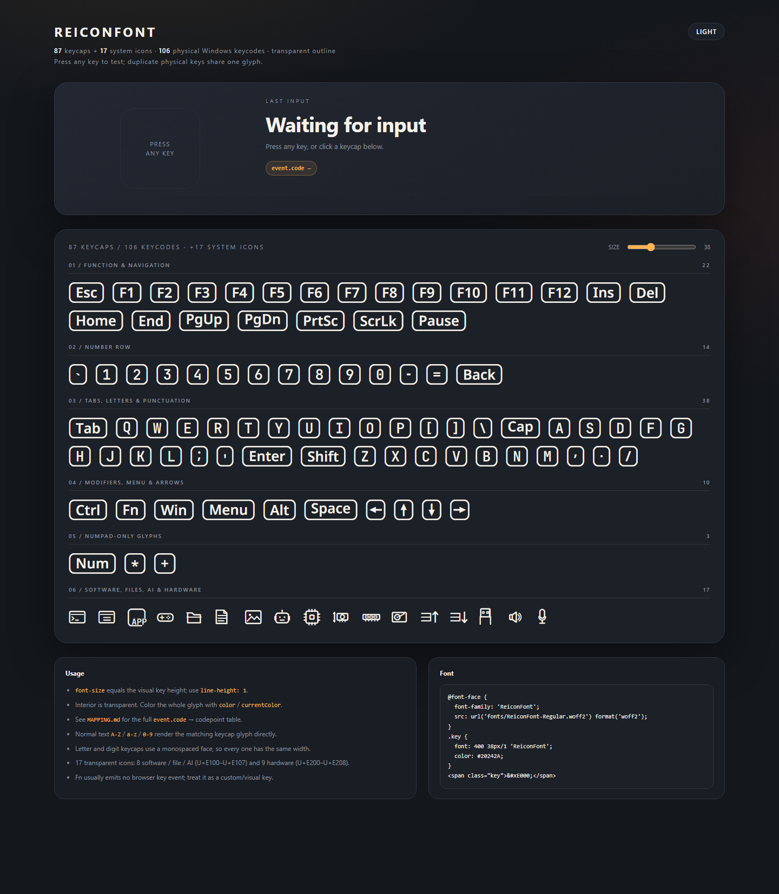

<h1 align="center">ReiconFont</h1>

<p align="center">
  <b>透明、贴合内容的键帽与系统图标字体：87 个键帽 + 17 个图标，共用一套 1em 网格。</b><br>
  <sub>A transparent, content-fitted keycap and system-icon font with 87 keycaps and 17 icons on a single 1em grid.</sub>
</p>

<p align="center">
  
  
  
  
</p>

<p align="center">
  
</p>

<p align="center">
  <a href="#简体中文">简体中文</a> · <a href="#english">English</a>
</p>

<a id="简体中文"></a>

依据实拍 Windows 键盘重绘。所有键帽边框、图例和系统图标都落在同一个 **1em / 62 设计单位** 的显示槽里，因此放大缩小都不会错位。字体只画轮廓，内部透明，颜色完全交给 `currentColor`。

## ✨ 特性

- **104 个字形** — 87 个键帽 + 17 个系统图标，覆盖 106 个 `event.code`
- **分区码位** — 键帽从 `U+E000` 起，软件图标从 `U+E100` 起，硬件图标从 `U+E200` 起
- **预留空位** — 每个分区各占 256 个码位，块内和块间的空位留给后续扩展
- **统一网格** — 每个字形占满 1em，键帽高 1000 字体单位，混排不跳动
- **透明内部** — 单色轮廓，跟随文字颜色，适合浅色 / 深色界面
- **精确映射** — 每个字形有固定 PUA 码位；`A–Z`、`a–z`、`0–9` 可直接当别名
- **等宽字母** — 字母和数字使用 JetBrains Mono SemiBold，单键宽度一致
- **内容自适应** — `Esc`、`Ctrl`、`PgUp` 等键帽按图例宽度收缩，不留空白
- **零运行时依赖** — 构建只需要 Python、`fonttools` 和 `brotli`

## 🚀 快速开始

到 **[Releases](https://github.com/CRITTIof/reicon-font/releases/latest)** 下载，三个文件按需选择：

| 文件 | 用途 | 说明 |
| --- | --- | --- |
| `ReiconFont-Regular.ttf` | 桌面安装 | Windows / macOS 双击安装 |
| `ReiconFont-Regular.woff2` | 网页字体 | 体积小，适合 `@font-face` |
| `MAPPING.md` | 映射文档 | 104 个 PUA、62 个 ASCII 别名、106 个 `event.code` |

许可证见仓库根目录的 [LICENSE](LICENSE)。

**桌面安装**：Windows 双击 TTF 选择“安装”；macOS 用“字体册”打开后选择“安装字体”。

**网页使用**：

```css
@font-face {
  font-family: "ReiconFont";
  src: url("fonts/ReiconFont-Regular.woff2") format("woff2");
  font-weight: 400;
  font-style: normal;
  font-display: block;
}

.key {
  font: 400 38px/1 "ReiconFont";
  color: currentColor;
}
```

`font-size` 就是键帽的视觉高度。保持 `line-height: 1`，颜色用 `color` / `currentColor` 控制。

**本地演示**：打开仓库里的 [demo.html](demo.html)，支持物理按键、点击键帽、明暗主题和字号调节，无需构建或本地服务器。

## 🧩 映射

每个字形有三种取法：

1. **PUA 码位** — 精确指定某个键帽或图标。
2. **ASCII 别名** — `A–Z`、`a–z`、`0–9` 直接映射到对应键帽；`A` 和 `a` 都显示大写 A。
3. **`event.code`** — 先查表转成码位，再渲染。

| 范围 | 内容 |
| --- | --- |
| `U+E000–U+E056` | 87 个键帽 |
| `U+E100–U+E107` | 8 个软件 / 文件 / AI 图标 |
| `U+E200–U+E208` | 9 个硬件图标 |
| `A–Z`、`a–z`、`0–9` | 键帽的 ASCII 别名 |

```html
<span class="key">&#xE000;</span>  <!-- Esc -->
<span class="key">&#xE100;</span>  <!-- CLI -->
<span class="key">&#xE200;</span>  <!-- CPU -->
<span class="key">A</span>         <!-- A 键帽 -->
```

字体本身不处理键盘事件。`demo.html` 里的 `KEYS` 数组包含全部 106 条映射，可以直接复制：

```js
document.addEventListener("keydown", (event) => {
  const key = KEYS.find((item) => item.code === event.code);
  if (key) output.textContent = String.fromCodePoint(key.codepoint);
});
```

完整中文对照表见 **[MAPPING.md](MAPPING.md)**。

<details>
<summary><b>17 个系统图标</b>（点击展开）</summary>

| 类别 | 图标与 PUA |
| --- | --- |
| 软件 | CLI `U+E100` · Web `U+E101` · App `U+E102` · Game `U+E103` |
| 文件 | Folder `U+E104` · TXT `U+E105` · Image `U+E106` |
| AI | AI Agent `U+E107` |
| 硬件 | CPU `U+E200` · GPU `U+E201` · RAM `U+E202` · ROM `U+E203` · NetUp `U+E204` · NetDown `U+E205` · USB `U+E206` · Vol `U+E207` · Mic `U+E208` |

</details>

## 🔨 构建

需要 Python 3.10+ 和 [requirements.txt](requirements.txt) 中的依赖。

```bash
python -m venv .venv
# Windows
.venv\Scripts\activate
# macOS / Linux
# source .venv/bin/activate

pip install -r requirements.txt
python src/build_font.py
```

输出：

```text
fonts/ReiconFont-Regular.ttf
fonts/ReiconFont-Regular.woff2
```

构建不依赖 Node.js、浏览器、图像库或网络。修改键位、图标分类和 PUA 分区看 `src/data.py`，修改轮廓和几何看 `src/geometry.py`，修改字体元数据看 `src/build_font.py`。

## ⚠️ 注意

- **不要用于正文。** ASCII 字母和数字被有意映射为键帽，正文请使用普通文本字体。
- **字体不知道键盘事件。** 需要自己把 `event.code` 映射到码位。
- 图标是象形符号，没有 `event.code`；`ROM` 沿用键盘丝印，但图形实际是硬盘。

## 📄 许可

字体以 **[SIL Open Font License 1.1](LICENSE)** 发布，可自由使用、嵌入、修改和再分发；再分发时请保留 `LICENSE`，不要单独售卖字体文件。用字体排版的文档、图片和网页不受该许可约束。

字形轮廓来自 **Noto Sans SemiBold**（Copyright 2018 The Noto Project Authors）和 **JetBrains Mono SemiBold**（Copyright 2020 The JetBrains Mono Project Authors），两者同样以 OFL 1.1 使用。生成字体命名为 **ReiconFont**，未使用源字体的保留名称。

<p align="center"><sub>ReiconFont v1.6.0 · 104 glyphs · SIL Open Font License 1.1</sub></p>

---

<a id="english"></a>

## English

**A transparent, content-fitted keycap and system-icon font**, redrawn from a photographed Windows keyboard. Every keycap frame and icon occupies the same **1em / 62-unit** slot, so they stay aligned at any size. The interior is transparent; color comes from `currentColor`.

- **104 glyphs** — 87 keycaps + 17 system icons, covering 106 `event.code` values
- **Blocked codepoints** — keycaps from `U+E000`, software icons from `U+E100`, hardware icons from `U+E200`
- **Reserved room** — each block spans 256 codepoints, leaving gaps for later additions
- **106 key mappings** and **62 ASCII aliases** (`A–Z`, `a–z`, `0–9`)
- **TTF + WOFF2**, 1000 units/em, all glyphs exactly 1em tall
- **Single-color outlines** with a transparent interior
- **No runtime dependencies**; build with Python, `fonttools` and `brotli`

### Quick start

Download the fonts from **[Releases](https://github.com/CRITTIof/reicon-font/releases/latest)**.

| File | Purpose |
| --- | --- |
| `ReiconFont-Regular.ttf` | Desktop install |
| `ReiconFont-Regular.woff2` | Web font |
| `MAPPING.md` | Full Chinese mapping reference |

The license is the [LICENSE](LICENSE) file at the repository root.

```css
@font-face {
  font-family: "ReiconFont";
  src: url("fonts/ReiconFont-Regular.woff2") format("woff2");
}
.key { font: 400 38px/1 "ReiconFont"; color: currentColor; }
```

```html
<span class="key">&#xE000;</span>  <!-- Esc -->
<span class="key">&#xE100;</span>  <!-- CLI -->
<span class="key">A</span>         <!-- A keycap -->
```

Use PUA codepoints for exact glyphs. ASCII letters and digits are aliases for the matching keycaps. **Do not use this font for body text.** See **[MAPPING.md](MAPPING.md)** for the full PUA / ASCII / `event.code` tables, or copy the `KEYS` array from [demo.html](demo.html).

### Build

```bash
pip install -r requirements.txt
python src/build_font.py
```

Outputs `fonts/ReiconFont-Regular.ttf` and `.woff2`. Python 3.10+ only; no Node.js, browser or image tooling required.

### License

Released under the **[SIL Open Font License 1.1](LICENSE)**. Outlines are derived from **Noto Sans SemiBold** (Copyright 2018 The Noto Project Authors) and **JetBrains Mono SemiBold** (Copyright 2020 The JetBrains Mono Project Authors), also under OFL 1.1. The generated font is named **ReiconFont** and uses no reserved name from either source font.

<p align="center"><a href="#简体中文">返回中文 ↑</a></p>
